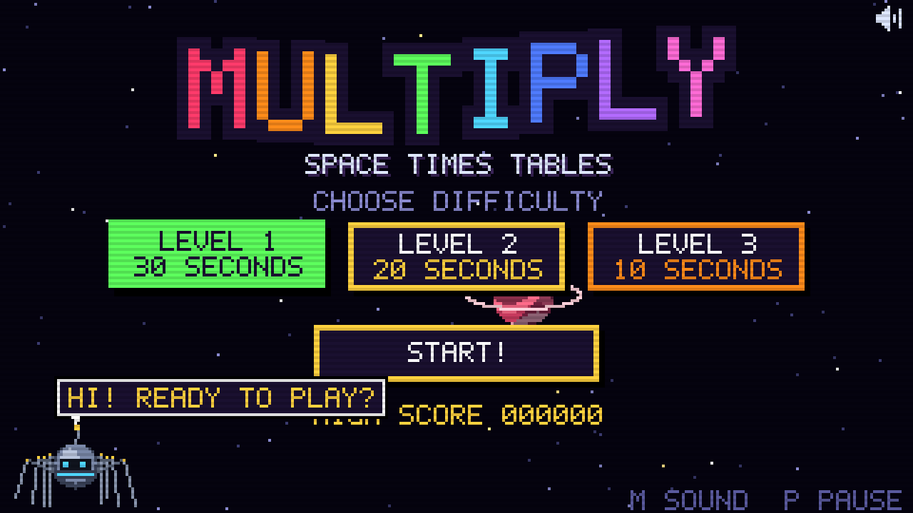
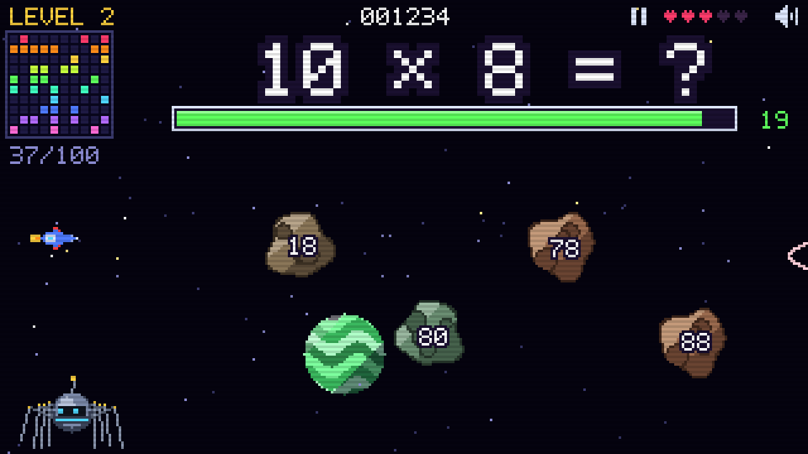
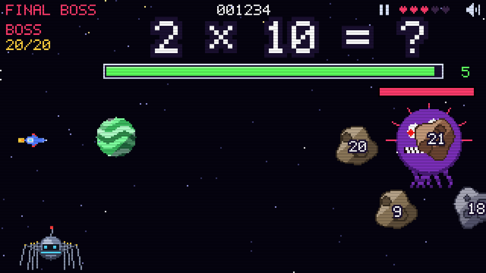

# Multiply 🚀

A tiny 8-bit, space-themed arcade game to practise the multiplication tables from 1 to 10.
Pure HTML + CSS + JavaScript: no dependencies, no build step, no network. Works offline by opening `index.html`.



| | |
| --- | --- |
|  |  |

## Play

```sh
make open    # open index.html in your default browser
make serve   # or serve it on http://localhost:8000
```

## How it works

- **Menu**: pick a starting difficulty and press **START**.
  - Level 1: 30 seconds per question
  - Level 2: 20 seconds per question
  - Level 3: 10 seconds per question
  - Final boss: 5 seconds per question
- A random multiplication appears (e.g. `7 × 8 = ?`) together with 4 asteroids. Shoot the one with the right answer before the time bar runs out.
- **No hints**: a wrong answer or a timeout costs a life, but the right answer is never revealed. The question comes back later.
- **Level up**: answer all 100 multiplications (1×1 … 10×10) correctly, in random order.
- **Bingo card** (top left): each correct answer lights a cell. Completing a whole table gives a **LINE!** bonus (+500 and +1 life). Completing the whole card is **BINGO!**, and you jump through hyperspace to the next level.
- **Final boss**: after Level 3, defeat the space monster (20 hits) at 5 seconds per question.
- 5 lives. The device's best final score is saved in the browser.
- The spider robot in the bottom-left corner cheers you on (it never gives hints).
- Works on phones and tablets: tap to play, best in landscape. The game pauses itself when the app goes to the background.

## Controls

| Action | Input |
| --- | --- |
| Shoot an asteroid | Click / tap it, or **type its number** on the keyboard |
| Typing | Matching digits light up on the asteroids; the shot fires as soon as only one number fits. Digits that match nothing are ignored. `Backspace` deletes, `Enter` confirms when one number is a prefix of another (e.g. `6` vs `60`) |
| Choose level in menu | Click, arrows or `1`–`3` |
| Start / confirm | `Enter` / `Space` |
| Pause | `P`, `Esc` or the ⏸ button on screen |
| Sound on/off | `M` or the speaker icon |

## Privacy

Only the best final score on this device (and the sound on/off setting) is saved, in the browser's `localStorage`. The game uses **no cookies**, needs no account and sends nothing anywhere.

## Development

```sh
make test    # unit tests for the question logic (node, no deps)
make check   # syntax-check every JS file
```

Project layout:

```
index.html, css/style.css
js/font.js       5x7 bitmap font
js/audio.js      WebAudio chiptune SFX and music
js/input.js      mouse / touch / keyboard
js/fx.js         starfield, planets, particles, lasers, shake, flashes
js/sprites.js    ship, asteroids, spider robot, boss
js/questions.js  question deck, distractors, line/bingo tracking (pure, tested)
js/game.js       state machine: menu, levels, warp, boss, game over, victory
js/main.js       main loop and boot
tests/           node tests
```

Debug URL parameters (dev only): `index.html?debug=1|2|3|boss|warp|gameover|victory`,
plus `&t=N` (fast-forward N seconds), `&pre=N` (pre-solve N questions), `&auto=1` (bot answers correctly) and `&keys=54` (simulate typing).

## License

MIT, see [LICENSE](LICENSE).
